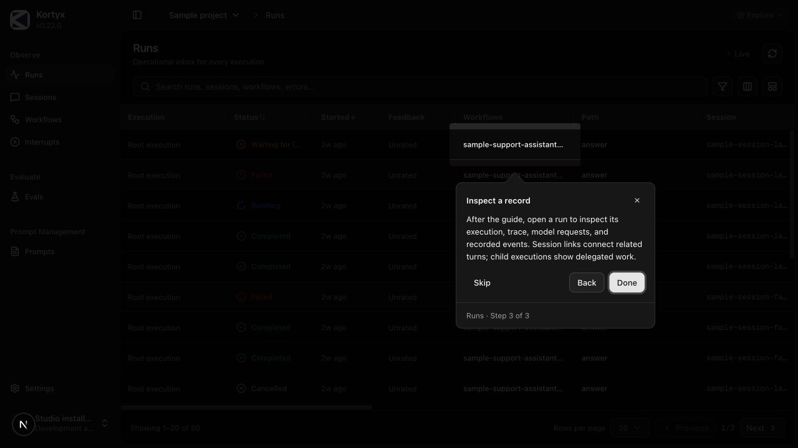
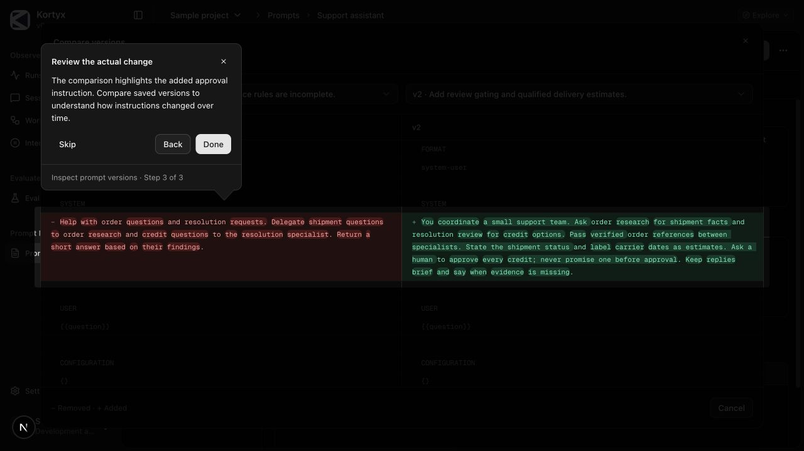
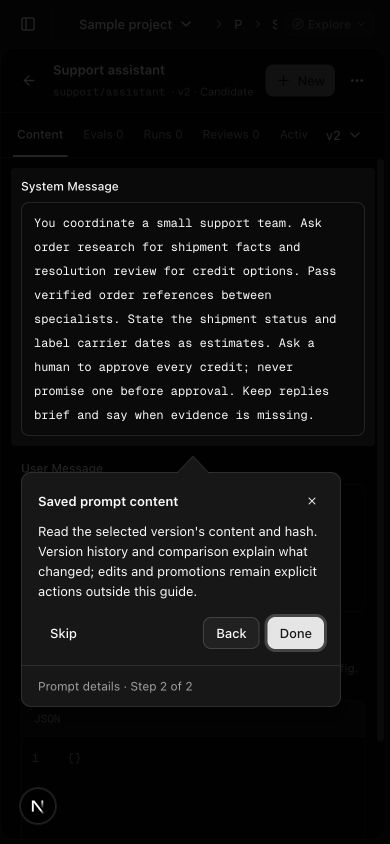
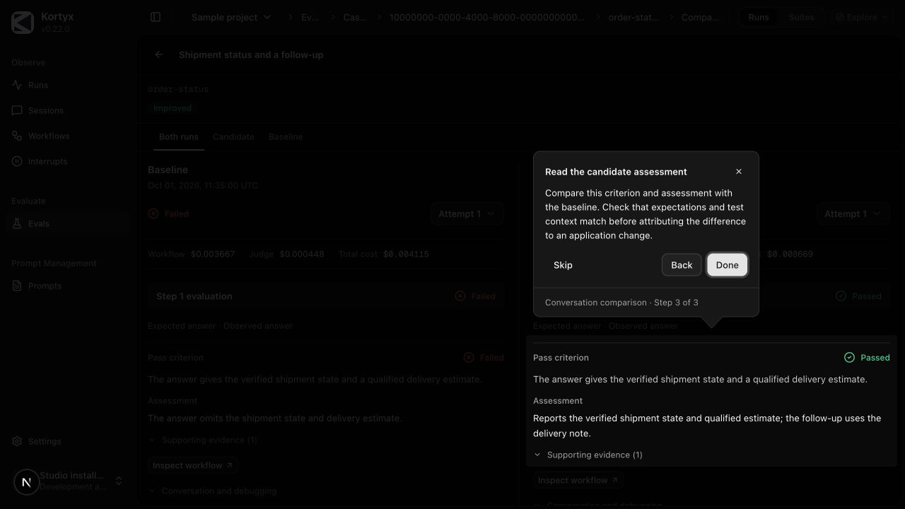

# Studio sample project and onboarding verification

This change provides the shared immutable sample project, selector visibility,
a learning hub, six core chapters, optional personalization, full-tour navigation,
explicit resume, and a shared OSS connection guide. See the
[user guide](../../studio/sample-project.md) and
[architecture and research](../../internal/studio-onboarding-plan.md).

## Acceptance and evidence

- Sample data projects canonical synthetic executions through production read models.
  Successful, failed, approved, follow-up, and baseline runs have stable identities.
  Fifty root runs share twenty sessions; saved evaluations reference synthetic fixtures.
  Domain schemas, failure evidence, comparison eligibility, and cross-links are tested.
- The registry restricts navigation to known read-only sample views. Chapter/step IDs
  and versions are checked against the bounded usage catalog. Stale or unsupported
  progress cannot provide an arbitrary navigation destination.
- Unit/DOM tests exercise the complete six-chapter controller flow, chapter breaks,
  previous-chapter navigation, pause/resume, reload recovery without auto-launch,
  skipping versus completion, missing targets, legacy migration, reset confirmation,
  and blocked storage. Runtime target tests cover route/query commit, hidden targets,
  settled geometry, stacked drawers, and comparisons above a drawer.
- Sample entry uses the authenticated preference endpoint, with explicit UI text when
  a hidden sample will be shown. Tests verify request ordering, failure and cancellation.
  Sample mutations remain denied and reads never fall through to customer records.
- Optional authorized edition/admin help links are bounded and validated. Existing
  edition onboarding remains authoritative; OSS now has a setup fallback with no
  managed account actions. Neither sample progress nor API reachability proves that
  an SDK application is connected.
- Browser specs remain configured, but **no E2E tests were run**. The subsequent
  onboarding review used one local Studio dev server and one active browser tab,
  at the user's request. Manual coverage and fixes are recorded below.

## Completion assessment

| Policy area | Assessment and evidence |
| --- | --- |
| Behavior and contracts | Implemented with typed views, stable IDs, bounded validated progress, canonical fixtures and schemas; pure state and DOM controller tests. |
| Studio integration | Shared OSS/Cloud shell, existing domain views and projector, all core chapter destinations, read-only comparison views and contextual entry points. Local OSS browser walkthrough verified below; private Cloud deployment remains unverified. |
| Documentation and examples | User/adapter guide, self-hosted guidance, architecture/research record, and package manifest guidance updated. |
| Kortyx skill | Studio reference teaches optional chapters/full tour and distinguishes learning from real integration verification. |
| Usage telemetry | Finite chapter/step/mode/version/failure facts, attempt semantics, honest skip/full completion, opt-out and content-exclusion regressions. |
| Customer observability | Canonical synthetic events retain correlations without ingesting/exporting customer traces. SDK exporters and runtime execution are unchanged. |
| Compatibility and extensions | Legacy quick-tour progress migrates; future history survives older readers; optional authorized help links and existing edition setup contracts remain additive. Private Cloud deployment/account-storage behavior was not verified. |
| Security and privacy | Existing authentication and server write denial retained. No real provider calls, credentials, account memberships, or customer copies. Progress accepts finite IDs, not navigation paths; entry cancellation and unsafe help destinations are tested. |
| Verification | Current checks and manual local browser coverage below. E2E, CI and production deployment checks remain outstanding. |
| Release and operations | Bundled dataset version 5 preserves IDs; dependencies/build exports retained. No DB migration/backfill or server progress store. Local progress migration is bounded. No deployment or container build performed. |

## Current local checks

All Vitest suites were run with **one worker**, sequentially between packages.
The local dev server was stopped before the full Studio regression suite.

- `pnpm --filter kortyx-studio exec vitest run --maxWorkers=1`: **415 tests passed in 83 files**, including the diagnostic fixtures and latest active-grading example.
- `pnpm --filter @kortyx/telemetry-contracts exec vitest run --maxWorkers=1`: **47 passed**.
- `pnpm --filter @kortyx/telemetry-db exec vitest run --maxWorkers=1`: **182 passed, 58 DB integration tests skipped** without their DB environment.
- `pnpm --filter @kortyx/usage-telemetry exec vitest run --maxWorkers=1`: **47 passed**.
- Studio, telemetry-contracts, telemetry-db and usage-telemetry type checks passed.
- telemetry-contracts, telemetry-db and usage-telemetry dependency builds passed.
- `pnpm install --frozen-lockfile --ignore-scripts` passed. The only dependency changes
  are the Studio telemetry-db workspace dependency and React Joyride v3 from the earlier slice.
- Biome checks changed sources. Existing non-null assertion/index-key warnings in
  prompt components remain; no new lint errors were introduced.
- Relative documentation links and `git diff --check` are checked before delivery.

## Manual onboarding review (2026-10-17)

Environment: local OSS Studio on `127.0.0.1:6327`, development auth mode `none`,
no configured API URL, credentials, database, or live producer. One active browser
tab, default 1280×720 viewport plus a temporary 390×844 mobile viewport. The
browser and dev server were closed after the review.

Visited the following through the UI:

- All six core chapters, including failed model evidence, two-turn session, topology,
  approval timeline/result, prompt versions/diff, suite, case evidence, and baseline
  comparison. The full walkthrough reached **6 completed, 0 skipped**.
- Back within a chapter and across chapter boundaries; reload paused at an execution
  step, a completed chapter break, and a prompt comparison; explicit Resume restored
  each checkpoint. Browser Back/Forward left the tour paused.
- Optional personalization, Escape exit with launcher focus restored, skipping,
  Finish for now, restart, reset confirmation, and persisted skipped/in-progress states.
- Hide an active sample, return to the real workspace, browser Back while hidden,
  explicit Show sample and resume, and return to the saved optional step. Real pages
  did not retain sample records. Opening the hub alone did not restore hidden data.
- Mobile selector and execution spotlights, visible controls, keyboard Enter/Back,
  real setup guidance, and explicit OSS selector entry without auto-launching a tour.

Fixed findings:

- The shared dialog lacked `data-slot="dialog-content"`, preventing the tour from
  recognizing a comparison above a drawer and weakening keyboard ownership.
- Retained full-page and intercepted drawer copies could select a background target.
  Readiness and Joyride now resolve the same visible foreground element. Prompt
  query-only steps use shallow history updates, avoiding duplicate comparisons.
- Comparison autofocus/outside interactions could steal focus or dismiss the diff
  underneath tour controls. Tour focus and interactions now keep the diff open.
- Deferred URL writes could navigate after a tour was cancelled. Scoped navigation
  accepts an abort signal; exiting aborts pending tour navigation. Step definitions
  remain stable across router changes.
- Prompt `compareWith` leaked into unrelated detail links; it is now stripped.
  Full-tour skip buttons now announce “Skip chapter” to assistive technology.

Local HTTP checks returned `200` for sample run reads and `403` for sample prompt
and evaluation writes. The same run endpoint without sample context returned `404`
in this unconfigured environment, rather than sample records. Existing unit
regressions cover authorization, unknown IDs, all mutation verbs, corrupt/blocked
storage, and bounded missing-target recovery; those failures were not injected into
the manual browser session.

The focused onboarding/dialog/navigation regression run passed **54 tests in 10
files**, including actual comparison-dialog focus and dismissal tests. The full
Studio regression suite and Studio type check were rerun after these fixes.

Not run for the full implementation: Playwright/E2E, Next production/selected-auth build smokes, container image
build, private Cloud deployment, and PR CI. The existing browser/CI gates remain
configured; they were not disabled to accommodate the local testing restriction.

## Onboarding design feedback (2026-10-18)

Implemented the collected UI feedback:

- One navbar **Explore** menu contains Explore Studio, Explain this page, and
  Documentation. Page help starts its matching chapter; real/hidden sample entry
  remains explicit. The documentation link opens `https://kortyx.io/docs`.
- The guide library shows every core chapter and a separate optional section,
  with icons, concise Start/Resume/Restart actions, and consistent card layout.
  Header and footer remain fixed; the middle area scrolls. Progress, reset and
  full-tour controls stay in the footer. Removed the expand/collapse guide switch
  and the connection/setup promotion section.
- Tooltips put an accessible exit × next to the title and chapter/step progress
  below the navigation buttons and a divider. An open-base outlined arrow joins
  the panel border. Theme tokens darken the area outside the spotlight (86% in
  dark mode, 64% in light mode).
- Tour and visible record narratives no longer repeatedly qualify events as
  fictional; the project selector still identifies the data as read-only sample
  data. Existing fixture IDs, progress versions and mutation boundaries remain.
- During light-mode verification, the optional Appearance guide revealed an
  oversized settings target that could place its tooltip off-screen. Settings
  now target the content card, with cross-axis viewport shifting as a fallback.

Manual checks used the already-running local Studio: Explore menu, matching page
help, short card actions, the tooltip arrow/exit/footer, dark and light appearance,
updated failure evidence, and the library at desktop and 390×844 mobile widths.
Scrolling the mobile library changed only its body scroll position; measured
header/footer positions stayed fixed. Restored the original System theme and
browser viewport afterward. The Studio server remains running for user testing.

The full Studio unit/DOM suite passed **402 tests in 81 files** with one worker.
Studio type checking and lint passed. The sample-data dependency build passed.
The browser specs were updated for the new menu/card selectors but **no E2E tests
were executed**. Production builds, private Cloud browser checks and CI remain
unrun. This feedback changes presentation and navigation entry points; SDK APIs,
customer execution collection, persistence formats and release exports are
unchanged. Existing bounded analytics and sample isolation checks remain in scope.

The follow-up UI feedback removed the page-wide sample notice (including its
recording date and clock explanation). The project selector retains its Sample
project entry. This is a presentation-only change; fixed-clock filtering and
server write denial remain unchanged. Existing browser specs now identify sample
scope through the selector instead of the removed notice; they were not run.

## Replacement dataset verification (2026-10-18)

Dataset version 3 replaces the earlier examples while preserving manifest and tour
identities. The bundle contains 50 root runs, 20 sessions, 55 child calls, three
workflows (one coordinator and two returning specialists), ten interrupts, and
three evaluations. Counts include every run status and every interrupt status.
Two interrupts remain pending without an expiry. Each of three prompt assets has
three saved revisions; evaluations retain their frozen prompt snapshots and usage.

The complete evaluation snapshots pass 3/6, 4/6, and 7/8 conversations. The final
snapshot adds a third suite. All seven suite runs contain definitions, observations,
criteria, grading reasons, tool evidence, costs, and links to synthetic executions.
The latest incomplete credit proposal intentionally fails its review criterion.

Privacy: inspected source execution shapes read-only, without exporting captured
content. All bundled content and metrics are authored fiction in an unrelated
support domain. No source tool names, transcripts, customer records, prompts,
identifiers, endpoints, or domain rules were copied into these fixtures.

Verification for this replacement:

- Studio: 406 tests passed in 81 files, one worker.
- telemetry-db: 181 tests passed; 58 DB integration tests skipped without a DB.
- telemetry-contracts: 47 tests passed.
- Type checks passed for Studio, telemetry-db, and telemetry-contracts.
- Workspace dependency builds passed; telemetry-db's sample export rebuilt.
- Changed-source Biome checks and `git diff --check` passed. Existing non-null
  assertion warnings in the extracted workflow-call reducer remain warnings.
- Manual local OSS browser checks at `http://127.0.0.1:6337`: 50-row run list;
  three workflows with 38 research and 17 resolution calls; a resolved approval's
  two returning child calls, two resolution attempts, completed wait, and cached
  research reuse; pending decision content and frozen timing; three prompt
  revisions; full evaluation suite results, history, costs, and comparable baseline.
  Browser error/warning log was empty. The task server and verification tab were
  closed afterward.
- Future-clock regression reprojects the fixtures in 2040 and verifies identical
  data, pending interrupts, workflow health, and call counts.
- No local Playwright E2E suite, full tour controller walkthrough, production/auth
  build, container build, deployment, or private Cloud check was run for this
  replacement. Existing PR-level release verification remains outstanding.

## Dataset v4 tour and active-evaluation review

Acceptance: every guide must resolve against the expanded fixtures, saved progress
must resume, and one evaluation must show completed results alongside unfinished
grading without future verdicts or live jobs.

- Manually completed all six walkthrough chapters (6 completed, 0 skipped) and the
  optional Personalize Studio chapter at `http://127.0.0.1:6327`. Checked the
  selector, run detail, failed error/trace/model request, two-turn session, child
  workflow topology, approval lifecycle, prompt revisions/diff, suite definition,
  completed result, case evidence, baseline comparison, and both settings targets.
- Verified Back between approval tabs, full-tour checkpoint recovery after reload,
  and exit/reload/resume at Quick orientation step 2 followed by successful detail
  navigation. Kept all chapter and step IDs unchanged.
- The orientation run is now searched by its stable ID, so saved sorting and a
  ten-row page cannot hide it. A regression checks the actual sample dispatcher.
- Reloading Workflows uncovered an injected `general-chat` filter that emptied
  the sample catalog. Removed the hard-coded workflow default and verified all
  three workflows remain visible after reload; explicit deep links still work.
- Candidate evaluation: 1/2 suites finished, 5/6 recorded outcomes, 4 passed,
  1 failed, 1 awaiting grading. Its quality suite shows two passed conversations
  and one running conversation. Opened that case and verified captured execution
  links, awaiting-evaluation steps, and zero judge cost with no future verdict.
  The completed latest evaluation and baseline used by the guide remain intact.
- Sample evaluation duration rendering and numeric filtering use the fixed sample
  clock; real projects retain live timers. No provider or database is invoked.
  Restored natural error/tool wording after the data replacement reintroduced
  “fictional” into the UI.
- Studio: `pnpm exec vitest run --maxWorkers=1`: **412 passed, 83 files**.
  `pnpm type-check` passed. `pnpm lint` passed with 142 existing warnings and
  one informational diagnostic. `git diff --check` passed.
- telemetry-contracts: `pnpm exec vitest run --maxWorkers=1`: **47 passed**.
  telemetry-db: `pnpm exec vitest run test/sample-project.test.ts --maxWorkers=1`:
  **2 passed**. Both dependency builds passed. Existing write-denial, no-network,
  scoped routing, clone isolation, tour targets, and usage allowlist regressions
  passed in the Studio suite.
- Browser logs contained one development Fast Refresh warning and no errors.
  Local E2E tests were intentionally not run at the user's request. Production/
  auth builds, container builds, deployment, private Cloud, and final-head CI were
  not verified here. No new SDK API, analytics event, persisted status, or migration
  was introduced; existing release boundaries remain unchanged.

## Dataset v5 error diagnostic coverage

Seven complete synthetic captures now populate the existing Error Diagnostic
page: five failed executions, one handled carrier error followed by a successful
retry, and one baseline evaluation with incomplete execution evidence. Propagated
span, tool, and child-call errors share the originating diagnostic. Quality-only
failures retain grading evidence without invented runtime exceptions.

- Captures include authored stack frames, nested cause stacks, codes, and runtime
  correlation. Applicable cases include timeout/model fields, carrier responses
  and validation issues, retry recovery, and consumed execution limits.
- Schema and cross-reference tests verify available content, correct hashes and
  byte counts, complete parts, redaction notes, every failed run's diagnostic,
  recovered-error handling, and evaluation/suite/case/runtime relationships.
- Server reads return the diagnostic envelope; browser reads and downloads return
  captured JSON content. Tests cover both API forms, invalid/unknown IDs, required
  environment scope, wrong-environment denial, authentication, hidden samples,
  write denial, and absence of real project credential or network access.
- Local browser checks covered failed run → Error Diagnostic, visible stack and
  cause, Capture details, successful JSON download, evaluation error dialog →
  diagnostic, and correlated evaluation/suite/runtime links. Browser warning and
  error logs were empty. Studio ran without an API, database, or credentials.
- Final combined branch: Studio **415 passed in 83 files**; telemetry-db **182
  passed, 58 DB integration skips**; telemetry-contracts **47 passed**. One worker
  per suite, with Studio stopped for the full regression run. Studio and DB type
  checks, changed-source lint, contract/DB builds, and diff checks passed.
- The v4 tour and active-grading changes are preserved. No local Playwright E2E,
  production/auth build, container/deployment, or private Cloud check was run for
  this follow-up. Final-head hosted CI remains a separate release requirement.

## Current-page explanations and explicit sample entry

Acceptance: Explain this page must use the current view and its visible data,
preserve project/record/query state, work on every primary Studio route, and never
switch to or reveal a sample without the explicit example choice. Page help must
leave saved walkthrough progress intact.

- Added a typed registry for list/detail views, prompt groups, suite/evaluation/
  case/comparison views, diagnostics, all settings sections, setup, and a general
  explanation for edition extension pages. A filesystem route-inventory test
  requires a specific explanation for each primary OSS route. Shared semantic
  anchors let future UI changes update the guides without fixture-specific IDs.
- Current page help captures only foreground element references and authored copy.
  It reads no record payloads, changes no filters/tabs, and performs no data writes.
  Selected run, prompt, session, approval, eval, and diagnostic tabs have local
  explanations. Missing controls are omitted; entering drawers are planned before
  animation and awaited before display. Background drawer evidence is excluded.
- Empty/unavailable views offer local control guidance or a matching sample
  example. Sample entry reuses the authenticated preference boundary and requires
  the explicit Open sample example choice, including hidden-sample disclosure.
  Unavailable sample access leaves local help enabled. No example is offered for
  pages without populated fixtures. An explicit sample-entry intent starts only
  the matching page's explanation and is consumed from history.
- Manual local browser: current run Events preserved its exact URL and tab;
  Sessions controls/row guidance; Workflows toolbar/catalog/map; diagnostic header,
  tabs, and evidence; settings navigation and selected-section help; prompt library
  and prompt v2 Activity; approval Timeline; evaluation case drawer (including
  immediate launch during entry, Back, and exit); baseline comparison. Browser
  error log was empty. A 390×844 prompt guide fitted its viewport; viewport reset.
- On the real unconfigured `/runs` view, declined sample entry and completed local
  guidance without navigation. Then explicitly accepted sample entry and verified
  `/sample/runs` opened its page explanation without starting a sample chapter.
  The real-data positive case, scoped project URLs, unavailable sample access,
  no-write/no-navigation behavior, and progress isolation have unit/DOM coverage;
  no connected real-project backend or private Cloud was used in this browser run.
- The hub retained all 6 completed chapters and optional-guide completion after
  page help. Replayed Quick orientation through selector, stable run, execution
  detail, and completion to check the shared tooltip extraction.
- Studio: `pnpm exec vitest run --maxWorkers=1`: **433 passed, 86 files**.
  Latest focused onboarding/usage checks: **65 passed, 10 files**. Studio type
  check passed. Lint passed with 142 existing warnings and one informational
  diagnostic. `git diff --check` passed. Usage telemetry: **47 tests passed**.
  telemetry-contracts and usage-telemetry builds passed.
- `studio.help` measures finite page/step/context/action facts separately from
  sample-tour completion and customer execution observability. Opt-out and payload
  exclusion tests passed. No new customer event, SDK API, migration, or dependency
  was introduced. User guidance, architecture, usage guidance, and Kortyx skill
  reference were updated. Existing private-edition integration/release checks
  remain pending; no local E2E, production/auth/container build, deployment, or
  private Cloud verification was performed.

## Usefulness and focused coverage review — October 18, 2026

Research/decisions: [usefulness assessment](../../internal/studio-onboarding-usefulness-review.md).
Kept six core chapters / 21 steps; added two optional three-step guides for full
diagnostic captures and evaluations still grading. New chapters use manifest IDs,
finite lesson views, and bounded analytics. Existing core completion is preserved.
Current detail-page explanations now skip generic tab and nested-table lessons.
Page-help visibility planning runs after commit instead of during render.

Verification for this change:

- `pnpm --filter @kortyx/telemetry-contracts build` and
  `pnpm --filter @kortyx/usage-telemetry build`: passed.
- `pnpm exec vitest run src/features/onboarding src/features/sample-project/sample-project.test.ts src/usage/client.test.ts --maxWorkers=1`
  from `apps/studio`: **82 passed / 11 files**. Includes actual pending grading and
  diagnostic evidence, unchanged queue length, optional checkpoint preservation,
  privacy/opt-out, and selected-view help.
- `pnpm type-check` and `pnpm lint` from `apps/studio`: passed; lint retains
  142 pre-existing warnings and one informational diagnostic.
- `pnpm exec vitest run --maxWorkers=1` from `packages/usage-telemetry`:
  **47 passed / 6 files**.
- `git diff --check`: passed. Documentation relative links checked.
- Manual CUA browser at `http://127.0.0.1:6327`: all three diagnostic steps, all
  three grading-progress steps, Back across case/suite navigation, Done,
  diagnostic exit/reload/explicit resume at step two, and no auto-reopening.
  Existing full-tour total stayed **6 of 6** after optional completion.
- Current case page help: two steps, retained the candidate suite/case/attempt URL
  and explained pending grading. Parent evaluation help retained its related-suite
  evidence in two steps without generic controls. Desktop and 390 × 844 mobile library cards,
  independent relevance/completion badges, body scrolling, and fixed header/footer
  visually checked. Browser error log empty. Saved review screenshot at
  `/tmp/kortyx-optional-guides.png` (local artifact, not a repository fixture).

No local E2E tests ran, per the user's memory constraint. This pass did not rerun
the whole Studio unit suite or production/selected-auth/container builds. Hosted
CI and private Cloud validation remain pending before merge. Research findings
are not a real-user study or evidence of improved activation/comprehension.

## Visual review fixes — October 18, 2026

Acceptance: each explanation points to readable, relevant evidence; its tooltip
stays in the viewport; current-page help preserves scope/tab/filter state; settings
and empty/error views avoid irrelevant steps; stable lesson IDs/progress and sample
read-only boundaries remain intact.

Resolved the visual audit's shared causes and individual lesson issues:

- Nested scrolling now measures viewport and ancestor clipping before showing a
  step. Joyride's second scroll is disabled because the shared target preparation
  performs the required horizontal/vertical scrolling. Table record targets use
  semantic columns, including prompt names rather than selection checkboxes.
- Placement uses the viewport instead of the narrow drawer's clipping boundary.
  Prompt lessons use the existing expanded detail view and highlight the saved
  message or changed diff hunk. Diagnostic/approval/model-failure targets expose
  the cause, capture integrity, linked run, recorded response, resolution event,
  and request/response capture availability.
- Evaluation guidance focuses on the criterion/assessment, saved baseline answer,
  pending case status, and expanded recorded conversation. Both runs page help
  explains baseline and candidate assessments in separate steps. Run topology
  describes observed activity; workflow guidance points to a readable catalog entry
  and the connection legend.
- Shared finite tab IDs require exhaustive help copy for actual Execution/calls,
  State, Metadata, Payload, and comparison tabs. The generic tab component still
  accepts edition-defined tabs when no built-in family is selected.
- Settings help is one section-specific step; selected appearance focuses its
  current option so stacked mobile cards remain readable. Credential/privacy/defaults
  copy matches the installed UI; errors lead directly to recovery. Empty prompt
  views acknowledge missing entries. Read-only narration distinguishes Next from
  actions to take after closing the guide. Removed remaining user-facing
  “fictional” settings wording; visible Test groups naming is consistent.

Manual CUA browser review captured **159 step screenshots**: all **29 chapter
steps**, **112 page-help steps across 56 desktop contexts**, and **18 mobile
steps**. The desktop contexts cover lists, detail tabs, workflows/health, prompts,
comparisons, diagnostics, local settings, setup, empty filters, and unavailable
real data. Mobile checks cover Runs, prompt content/version/diff, appearance,
approvals, diagnostics, and both comparison assessments. Screenshots were visually
reviewed, revised where needed, and recaptured. Tooltip rectangles also passed a
viewport-bound check. Existing six core chapters / 21 steps and all lesson IDs
remain unchanged.

Back from the prompt comparison returned to saved version two. Reload kept the
overlay closed; explicit Resume restored step two, and finishing restored chapter
completion. Current-page explanations preserved their URLs. The unconfigured real
Runs page offered the sample choice; local explanation stayed on its error.
Browser errors were empty during the final resume check. One dev server and one
active browser tab were used; no connected customer data or private Cloud instance
was available.

Representative captures (the complete local gallery is an external review artifact):

| Record target | Actual prompt diff |
| --- | --- |
|  |  |

| Mobile prompt evidence | Candidate assessment |
| --- | --- |
|  |  |

Final verification:

- `pnpm -C apps/studio exec vitest run --maxWorkers=1`: **453 tests passed in 89 files**.
- `pnpm -C apps/studio type-check`: passed.
- Changed-source Biome: no errors; 13 existing warnings and one informational
  diagnostic in touched files. Relative links and `git diff --check` passed.
- Final touched guide UI reviewed against the repository's Web Interface
  Guidelines skill: labeled native buttons, focus, readable/clipped evidence,
  semantic content, URL state, and missing-data behavior checked. This is not a
  full Studio accessibility audit.

**No E2E tests ran**, per the user's memory constraint. Production/auth/container
builds, final-head CI, and private Cloud integration remain pending before merge.
Prompt-group detail has no sample fixture; generic extension pages and private
Cloud settings were not visually verified. Coverage is representative mobile in
dark mode, not every viewport/theme combination or a user-comprehension study.

## Rebase coverage — October 18, 2026

Rechecked `origin/main` at `2d2dda75`: the branch was already up to date.
The 53-file table-state change in #364 introduces no routes or detail tabs, but
changes shared Filters, Columns, and Views controls on Runs, Sessions,
Interrupts, Prompts/Test groups, evaluation lists, and nested evaluation tables.
The preceding full visual review includes this base change. Updated current-page
list help to explain Match all/any, numeric/date bounds, column order/visibility/
pins, and the saved search/sort/layout contract. Existing task chapters and stable
IDs remain sufficient; no extra mandatory steps were added.

Hosted CI exposed an older filter URL acknowledgement overwriting newer invalid
range input. Retain newer drafts while acknowledging earlier own writes; external
navigation/reset remains authoritative. A focused DOM regression covers the
invalid range, delayed acknowledgement, corrected `[0, 0]` range, and reset.
Manual local Studio verification confirmed the validation message, both zero
bounds and the `between` URL, filter clearing, and the updated current-page guide.
The error log was empty. Local proof captures are
`/tmp/kortyx-rebase-zero-range.png` and `/tmp/kortyx-rebase-page-help.png`.

The PR template now explicitly requires assessing and completing related guided
tours/page help, including new surfaces inherited after rebase. The Definition of
Done owns the detailed requirement; contributor and agent instructions point to it.

Verification: **454 Studio unit/DOM tests passed in 89 files**. Hosted failure
reports also identified stale tour wording/accessibility selectors and cold Next
development-route assertions reaching their five-second deadline during compile.
Updated those assertions without removing coverage or disabling gates. No local
E2E tests ran; final-head hosted CI is recorded in the PR before merge.

The next hosted run passed the range-filter shard and exposed a separate feedback
test isolation issue: cold drawer compilation consumed 13 seconds of a 30-second
multi-page journey, and its retry inherited the saved review. Reset the fixture's
human review before each attempt (preserving the read-only key path) and give that
single save/edit/reload journey 60 seconds. All assertions remain in place.

That review job passed on the following head. A separate autocomplete assertion
read the typed fallback before remote suggestions arrived, then selected the
newly loaded first option. Wait for the seeded remote suggestion before recording
the expected keyboard selection. This retains remote-lookup and free-text checks.
